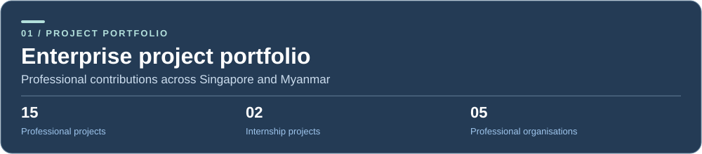

---

15 professional projects and two internship projects across Singapore and Myanmar. These are descriptions of professional contributions, not public source-code repositories.

### Explore by organisation

## RF360 – Qualcomm

**01 / Semiconductor manufacturing · Singapore** · 4 projects

### Fixed Asset Management System

Enterprise system for asset tracking and approval workflows.

**Technology stack**

           

---

### ProMIO Application

Large-scale manufacturing system supporting complex workflows.

**Technology stack**

               

---

### ProMIO Administration Web Application

Web application for configuring customised sampling process rules in ProMIO and connecting to ProMIO through APIs.

**My contributions**

Development, bug fixing, SIT, UAT, implementation and reporting.

**Technology stack**

   

---

### Nachlaser Application

Web and Windows applications supporting user administration and reading and generating panel files for inking processes using a Web API.

**My contributions**

Development, bug fixing and SIT.

**Technology stack**

           

---

## Toppan Forms

**02 / Business process automation · Singapore** · 4 projects

### NTUC Lodgement Reporting

Windows application generating reports by processing batch files imported from another system.

**My contributions**

Development, screen design, bug fixing, SIT, UAT, implementation and reporting.

**Technology stack**

  

---

### JAS Emailing

Console application sending customer emails with attachments by processing batch files.

**My contributions**

Development, screen design, bug fixing, SIT, UAT, implementation and reporting.

**Technology stack**

   

---

### Web Portal

Web application supporting customer email delivery and batch-file processing.

**My contributions**

Development, screen design, bug fixing, SIT, UAT, implementation and reporting.

**Technology stack**

         

---

### MOHH PDF Program

Windows application for reading and ordering PDF files.

**My contributions**

Development, screen design, bug fixing, SIT, UAT, implementation and reporting.

**Technology stack**

  

---

## Etiqa Insurance

**03 / Insurance · Singapore** · 1 project

### Staff Portal

Internal HR system supporting staff operations and employee management.

**Technology stack**

         

---

## True Yoga & True Fitness

**04 / Health & fitness · Singapore** · 2 projects

### True Calling System

Web application supporting automated calls to members by operators.

**My contributions**

Development, screen design, bug fixing, SIT, UAT, implementation and reporting.

**Technology stack**

        

---

### Customer Booking Schedule System

Developed a customer booking web application enabling fitness club members to make and manage club bookings.

**My contributions**

Contributed to development, screen design, bug fixing and application support.

**Technology stack**

         

---

## ACE Data Systems

**05 / Banking & financial services · Myanmar** · 4 projects

### Merchant Portal

Developed a web application for the bank’s card department to view and manage customer card transaction information and generate transaction reports.

**Technology stack**

          

---

### Auto Mailing System

Windows application automatically sending emails to clients with their transaction data.

**My contributions**

Development, project planning, requirements gathering, system design, screen design, bug fixing, SIT, UAT, implementation and reporting.

**Technology stack**

   

---

### Microfinance Systems

End-to-end microfinance solution supporting customer information management, loan management, area surveys, biometric authentication, and secure third-party payment integration between the 1-Stop payment platform and the ACE core microfinance system.

**Technology stack**

          

---

### Centralized Core Banking System

Integrated end-to-end banking system supporting platform, teller, loans, transfer and clearing, system administration, general ledger and management functions.

**My contributions**

Requirements gathering, system design, development and implementation of Windows applications for internal users.

**Technology stack**

      

---

## Internship projects

**06 / On-the-job training · Myanmar** · 2 projects

**ACE Data Systems — ACE Software Training | Software Development Intern (Programmer, OJT)**

### Inventory Control System

May 2013 – September 2013 · Windows and web applications

System supporting customer management, supplier management, purchase orders and sales orders.

**My contributions**

Project planning, requirements gathering, scope management, system design, development, SIT, UAT, implementation, reporting and training.

**Technology stack**

     

---

### Online Home Budget Management System

October 2013 – February 2014 · Web application

System for recording income and expense transactions.

**My contributions**

Requirements gathering, system design, development, SIT, UAT, implementation and reporting.

**Technology stack**

     

---

