

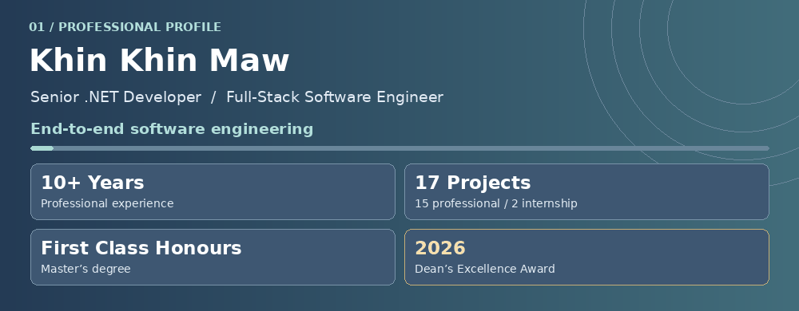

<h3 align="center">Senior .NET Developer · Full-Stack Software Engineer</h3>

Enterprise Software Engineering | AI-Assisted Development | Cloud & DevOps

Auckland, New Zealand

---

     

## About Me

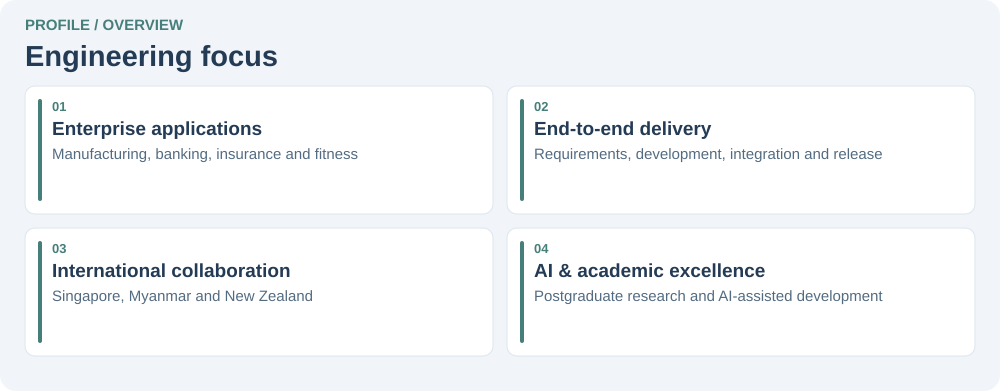

I am a **.NET Full-Stack Software Developer with over 10 years of professional experience** delivering end-to-end enterprise software solutions across semiconductor manufacturing, banking and financial services, insurance, business process automation, and health and fitness in Singapore and Myanmar.

My experience spans the complete **Software Development Life Cycle (SDLC)** — from requirements gathering and analysis, solution design and architecture, frontend and backend development, database design and development, and API development to system integration, testing, deployment, release support, production maintenance and continuous improvement.

My core expertise includes C#, ASP.NET, .NET Core, Web APIs, SQL Server, JavaScript, Vue.js, Azure DevOps and CI/CD pipelines. My broader technical experience includes React, TypeScript and modern web technologies. I have worked on enterprise integrations, secure third-party payment services and business process automation, collaborating with international and cross-functional teams in Agile/Scrum environments.

I completed my **Master of Computer and Information Sciences with First Class Honours** at Auckland University of Technology (AUT), New Zealand, and received the **Dean’s Award for Excellence in Postgraduate Study (2026)**. My postgraduate research, **Impact of AI Tools Across Software Engineering Phases in Large-Scale Software Development**, was conducted using a Multivocal Literature Review (MLR) protocol. I currently work as a part-time Teaching Assistant at AUT, supporting learning activities and IT project management concepts.

I am interested in combining enterprise software engineering, modern software architecture, cloud technologies and AI-assisted development to deliver scalable, secure, reliable and maintainable solutions.

Based in Auckland, New Zealand · Open to software engineering opportunities and professional collaboration.

---

## Technical Expertise

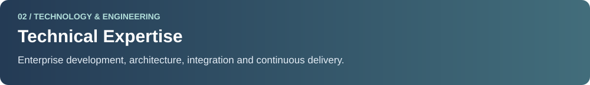

<table width="100%">
<tr><td width="50%" valign="top">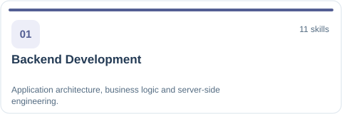       

<b>Explore technology stack</b>
           
C#, .NET, .NET Core, ASP.NET, ASP.NET Core, ASP.NET MVC 5, LINQ, Entity Framework, Spring.NET, NHibernate, Express.js

</td><td width="50%" valign="top">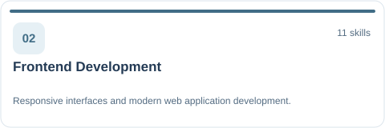             

<b>Explore technology stack</b>
           
JavaScript, TypeScript, Vue.js, React, Angular, Next.js, HTML5, CSS3, Bootstrap, jQuery, AJAX

</td></tr>
<tr><td width="50%" valign="top">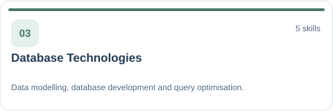     

<b>Explore technology stack</b>
     
SQL, Microsoft SQL Server, SQLite, Stored Procedures, Database Design

</td><td width="50%" valign="top">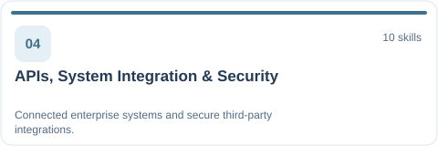     

<b>Explore technology stack</b>
          
REST APIs, Web APIs, Web Services, XML, XSLT, JSON, JWT, Third-Party Integration, Payment Integration, Biometric Authentication

</td></tr>
<tr><td width="50%" valign="top">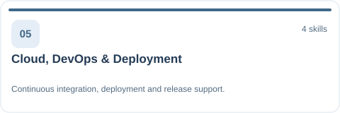     

<b>Explore technology stack</b>
    
Microsoft Azure, Azure DevOps, CI/CD Pipelines, IIS Web Server

</td><td width="50%" valign="top">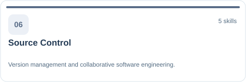      

<b>Explore technology stack</b>
     
Git, GitHub, SVN, TFS, Visual SourceSafe

</td></tr>
<tr><td width="50%" valign="top">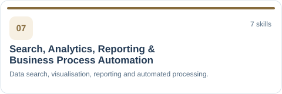     

<b>Explore technology stack</b>
       
Elasticsearch, Kibana, Crystal Reports, Microsoft Report Viewer, Batch Processing, PDF Processing, Email Automation

</td><td width="50%" valign="top">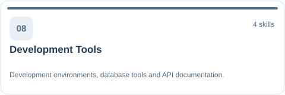      

<b>Explore technology stack</b>
    
Visual Studio, Visual Studio Code, SQL Server Management Studio, Swagger

</td></tr>
<tr><td width="50%" valign="top">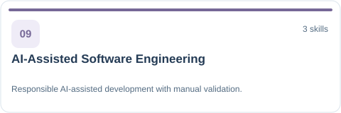    

<b>Explore technology stack</b>
   
GitHub Copilot, Generative AI, AI-Assisted Development

</td><td width="50%" valign="top">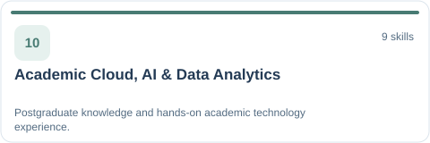     

<b>Explore technology stack</b>
         
Python, AWS, Amazon EMR, Amazon S3, Artificial Intelligence, Machine Learning, Data Mining, Data Warehousing, Statistical Programming

</td></tr>
</table>

*Technology experience varies by project; AWS, machine learning and data analytics are included as academic experience.*

---
## End-to-End SDLC Experience

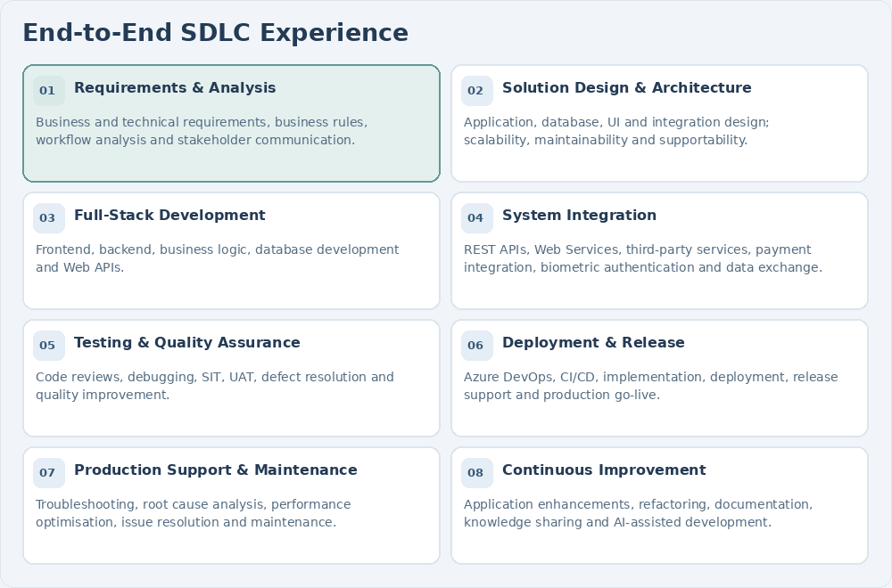

<b>Explore the eight lifecycle phases</b>

**01 / Requirements & Analysis** — Business and technical requirements, business rules, workflow analysis and stakeholder communication.

**02 / Solution Design & Architecture** — Application, database, UI and integration design; scalability, maintainability and supportability.

**03 / Full-Stack Development** — Frontend, backend, business logic, database development and Web APIs.

**04 / System Integration** — REST APIs, Web Services, third-party services, payment integration, biometric authentication and data exchange.

**05 / Testing & Quality Assurance** — Code reviews, debugging, SIT, UAT, defect resolution and quality improvement.

**06 / Deployment & Release** — Azure DevOps, CI/CD, implementation, deployment, release support and production go-live.

**07 / Production Support & Maintenance** — Troubleshooting, root cause analysis, performance optimisation, issue resolution and maintenance.

**08 / Continuous Improvement** — Application enhancements, refactoring, documentation, knowledge sharing and AI-assisted development.

## Professional Software Engineering Skills

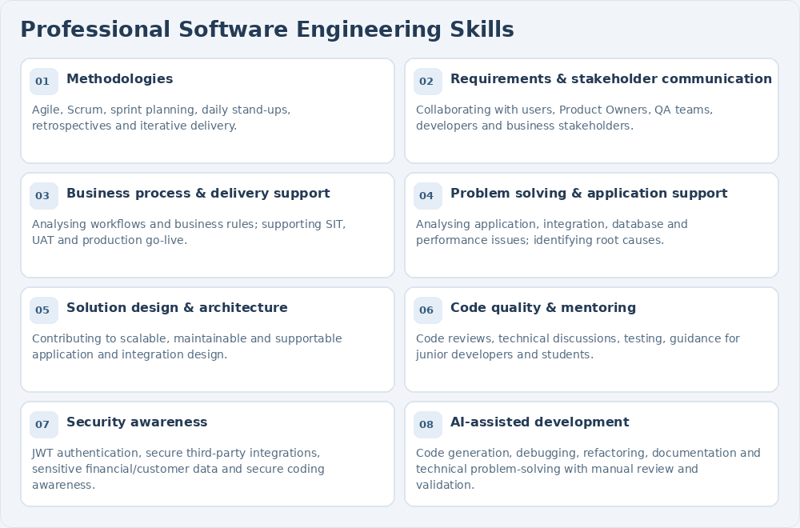

<b>Read detailed professional competencies</b>

**Methodologies** — Agile, Scrum, sprint planning, daily stand-ups, retrospectives and iterative delivery.

**Requirements & stakeholder communication** — Collaborating with users, Product Owners, QA teams, developers and business stakeholders.

**Business process & delivery support** — Analysing workflows and business rules; supporting SIT, UAT and production go-live.

**Problem solving & application support** — Analysing application, integration, database and performance issues; identifying root causes.

**Solution design & architecture** — Contributing to scalable, maintainable and supportable application and integration design.

**Code quality & mentoring** — Code reviews, technical discussions, testing, guidance for junior developers and students.

**Security awareness** — JWT authentication, secure third-party integrations, sensitive financial/customer data and secure coding awareness.

**AI-assisted development** — Code generation, debugging, refactoring, documentation and technical problem-solving with manual review and validation.

---

## Featured Enterprise Projects

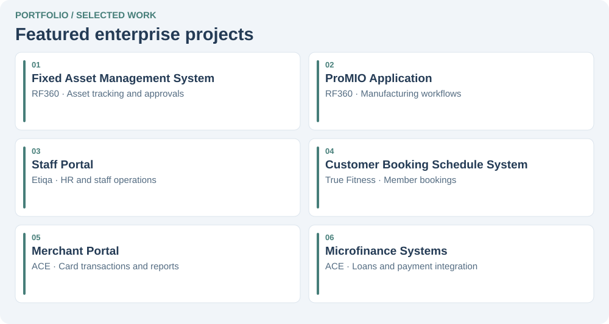

<b>Read detailed featured enterprise projects</b>

Selected professional contributions. These are not public source-code repositories.

### Fixed Asset Management System

Enterprise system for asset tracking and approval workflows.

**Technology stack** · .NET Core, HTML, CSS, Bootstrap, JavaScript, jQuery, AJAX, JSON, Web APIs, SQL, Azure DevOps, CI/CD pipelines

### ProMIO Application

Large-scale manufacturing system supporting complex workflows.

**Technology stack** · C#, .NET Core, Web APIs, LINQ, SQL, JavaScript, Vue.js, HTML, CSS, Bootstrap, jQuery, AJAX, JSON, SQL Server, Azure DevOps, CI/CD pipelines

### Staff Portal

Internal HR system supporting staff operations and employee management.

**Technology stack** · C# .NET, MVC 5, Angular, Bootstrap, JavaScript, jQuery, AJAX, JSON, Web APIs, SQL

### Customer Booking Schedule System

Developed a customer booking web application enabling fitness club members to make and manage club bookings.

**Technology stack** · C#, .NET, JavaScript, HTML, CSS, jQuery, AJAX, JSON, SQL Server, IIS Web Server

### Merchant Portal

Developed a web application for the bank’s card department to view and manage customer card transaction information and generate transaction reports.

**Technology stack** · C#, .NET MVC 5, LINQ, HTML, CSS, JavaScript, jQuery, Bootstrap, SQL Server, Crystal Reports 2015, IIS Web Server

### Microfinance Systems

End-to-end microfinance solution supporting customer information management, loan management, area surveys, biometric authentication, and secure third-party payment integration between the 1-Stop payment platform and the ACE core microfinance system.

**Technology stack** · C#, .NET, LINQ, XML, XSLT, Web Services, IIS Web Server, SQL Server, SQLite, biometric integration, Microsoft Report Viewer

## Professional & Academic Journey

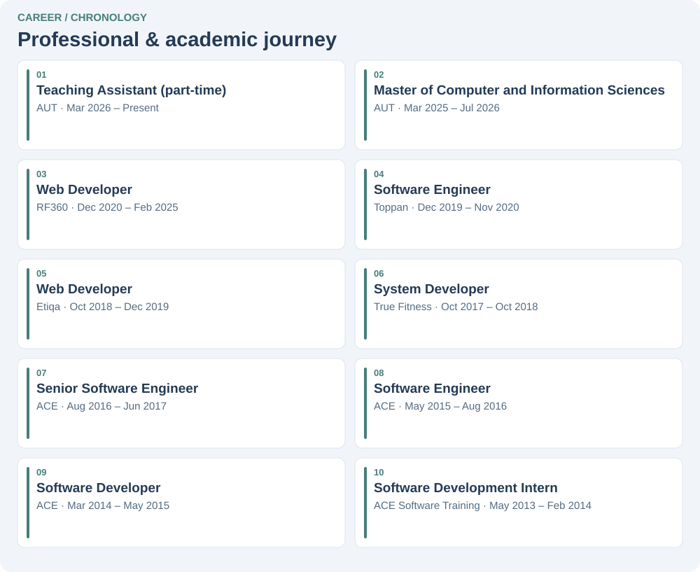

<b>Read detailed professional & academic journey</b>

### Teaching Assistant (part-time)

**Auckland University of Technology, New Zealand** · Mar 2026 – Present

### Master of Computer and Information Sciences (Full-time postgraduate study)

**Auckland University of Technology, New Zealand** · Mar 2025 – Jul 2026

### Web Developer

**RF360 – Qualcomm, Singapore** · Dec 2020 – Feb 2025

### Software Engineer

**Toppan Forms, Singapore** · Dec 2019 – Nov 2020

### Web Developer

**Etiqa Insurance, Singapore** · Oct 2018 – Dec 2019

### Developer

**True Yoga & True Fitness, Singapore** · Oct 2017 – Oct 2018

### Senior Software Engineer

**ACE Data Systems, Myanmar** · Aug 2016 – Jun 2017

### Software Engineer

**ACE Data Systems, Myanmar** · May 2015 – Aug 2016

### Software Developer

**ACE Data Systems, Myanmar** · Mar 2014 – May 2015

### Software Development Intern (Programmer, OJT)

**ACE Data Systems — ACE Software Training, Myanmar** · May 2013 – Feb 2014

## Internship Projects

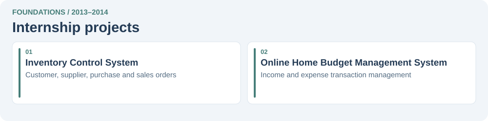

<b>Read detailed internship projects</b>

**ACE Data Systems — ACE Software Training | Software Development Intern (Programmer, OJT)**  
May 2013 – February 2014 · Myanmar

### Inventory Control System

Customer and supplier management, purchase orders and sales orders.

**Technology stack** · C#, ASP.NET, LINQ, JavaScript, jQuery, SQL Server

### Online Home Budget Management System

Recording income and expense transactions.

**Technology stack** · C#, ASP.NET, LINQ, JavaScript, jQuery, SQL Server

## Education & Academic Achievements

**Master of Computer and Information Sciences — First Class Honours**  
Auckland University of Technology, New Zealand · March 2025 – July 2026  
🏆 Dean’s Award for Excellence in Postgraduate Study (2026)

**Bachelor of Information Technology (BE.IT)**  
Technological University, Myanmar · October 2008 – December 2012

## Research & AI Interests

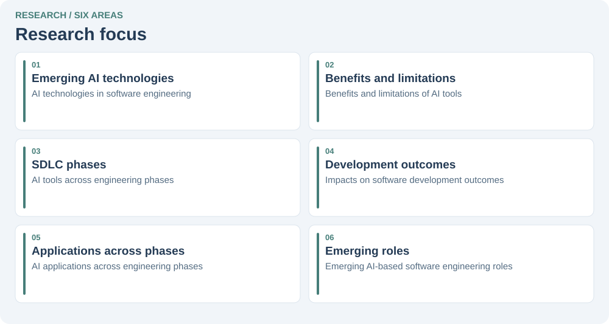

**Impact of AI Tools Across Software Engineering Phases in Large-Scale Software Development**

Postgraduate research conducted using a Multivocal Literature Review (MLR) protocol, exploring AI tools in large-scale software engineering.

---

<strong>Building reliable software. Connecting enterprise experience with AI-enabled innovation.</strong>

