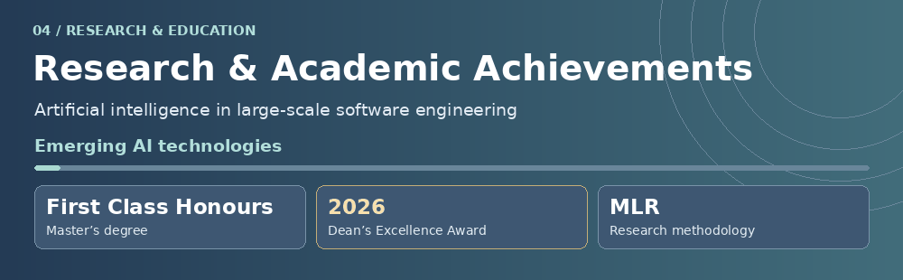
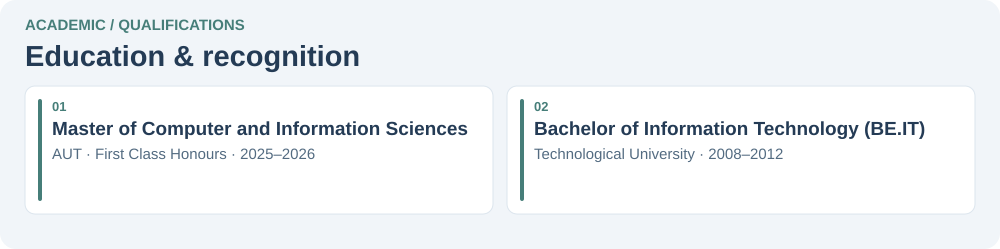
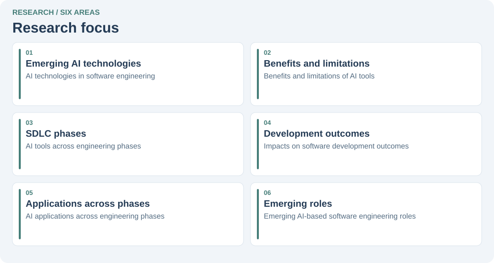
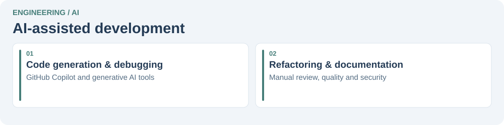

---

## Master of Computer and Information Sciences

**Auckland University of Technology (AUT), New Zealand**  
March 2025 – July 2026

Dean’s Award for Excellence in Postgraduate Study (2026).

---

## Dissertation

### Impact of AI Tools Across Software Engineering Phases in Large-Scale Software Development

**Research methodology:** Multivocal Literature Review (MLR)

Conducted using a Multivocal Literature Review protocol, focusing on the impact of AI tools across software engineering phases in large-scale software development.

### Research focus

**01 / Emerging AI technologies**  
AI technologies emerging in software engineering.

**02 / Benefits and limitations**  
Benefits and limitations of AI tools in software engineering.

**03 / SDLC phases**  
AI tools across individual software engineering phases.

**04 / Development outcomes**  
Impacts on software development outcomes.

**05 / Applications across phases**  
Applications of AI across software engineering phases.

**06 / Emerging roles**  
Emerging AI-based software engineering roles.

---

## AI-assisted development

Professional experience using GitHub Copilot for code generation, debugging, refactoring, documentation and technical problem-solving, with manual review and validation to maintain code quality, security and maintainability.

---

## Undergraduate education

**Bachelor of Information Technology (BE.IT)**  
Technological University, Myanmar · October 2008 – December 2012

---

